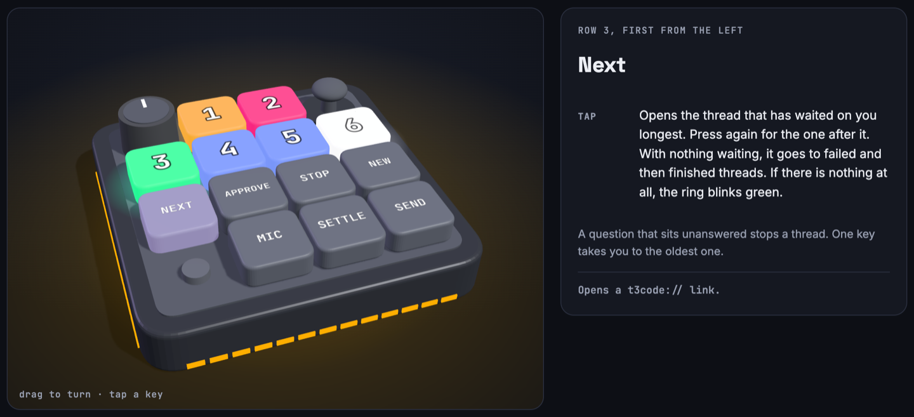

<div align="center">

# 🎛️ T3 Micro Bridge

### Your T3 Code threads on a Work Louder Creator Micro 2.

Six keys light up with the state of your T3 Code threads and open them. The other keys, the knob and the joystick jump to the thread that waits on you, stop a run, take dictation, settle a thread and send. It does for T3 Code what the pad's ChatGPT layer does for Codex, on a layer of its own.

[![CI][ci-badge]][ci-workflow]
[![License: MIT][license-badge]][license-file]
[![Platform: macOS][platform-badge]](#-what-you-need)
[![Swift 5][swift-badge]][swift]
[![Works with T3 Code][t3-badge]][t3]

[🚀 Quick start](#-quick-start) · [⌨️ Keys](#️-the-keys) · [🚦 Lights](#-the-lights) · [🧰 Commands](#-cli-reference) · [🛡️ Security](#️-security-and-privacy) · [💖 Support](#-support-the-project)



</div>

With several agent threads running, the slow part is noticing which one needs you. The pad shows it without a window switch: a key pulses orange when a thread waits on your answer, and one press opens it. The bridge only takes the pad while it is on the T3 Code layer, so Codex keeps working on its own layer.

- 🚦 **Thread lights**: orange for waiting on you, red for failed, green for finished, blue for working, white for idle. The ring around the pad shows the most urgent state of every open thread.
- 🎯 **The six keys follow urgency**: what waits on you comes first, longest wait first. Or they follow the T3 Code sidebar, if you prefer its order.
- ⏭️ **NEXT**: one key opens the thread that has waited on you longest, then the one after it.
- ⌨️ **One press per action**: approve, stop the run, new thread, dictate, settle, send. The knob steps through threads and picks a model.
- 🎚️ **Simple and advanced modes**: start with one action per key. Advanced adds a second action on a hold and turns the joystick on.
- 🖥️ **More than one T3 server**: the keys can mix threads from the desktop app and from other T3 servers on the same Mac. `t3-micro2 spaces` lists them.
- 🤝 **Your shortcuts**: the bridge reads T3 Code's keybindings file, so shortcuts you changed still work.
- 🩺 **One command**: `t3-micro2 setup` installs it, `status` and `doctor` check it, `uninstall` removes it.

> [!IMPORTANT]
> This is not a product of T3 Code, Work Louder or OpenAI. It uses interfaces none of them document: the pad's USB protocol and a local T3 Code endpoint. An update to the pad's firmware or to T3 Code can break it. It was built and tested on one pad (firmware 0.6.3) and one Mac. Setup changes the keymap file on the pad and keeps a copy of the old one. See [🛡️ Security and privacy](#️-security-and-privacy).

## 🧰 What you need

| What                        | Details                                                                                                         |
| --------------------------- | --------------------------------------------------------------------------------------------------------------- |
| 🍎 **A Mac**                | macOS 13 or later. Tested on macOS 27 with Apple silicon.                                                       |
| 🎛️ **The pad**              | A Work Louder Creator Micro 2 that has a ChatGPT layer, connected by USB. Tested with firmware 0.6.3.           |
| 💬 **T3 Code**              | The desktop app, opened at least once.                                                                          |
| 🛠️ **Apple's command line tools** | For the Swift compiler. `xcode-select --install` installs them. Setup builds the app on your Mac.         |
| 🧩 **A free layer on the pad** | Setup turns an empty layer into the T3 layer. With none empty, you choose which layer to replace.            |

Work Louder's Input app and the ChatGPT app are not needed. If you use them, they keep working.

## 🚀 Quick start

### 1. Install

**Through your agent:** open a session in your coding agent (Claude Code, Codex, T3 Code or similar) and paste this line:

```text
Install T3 Micro Bridge from https://github.com/kdpa-llc/t3-micro2 by following the Quick start section of its README.
```

**By hand:** run these commands in a terminal.

```bash
git clone https://github.com/kdpa-llc/t3-micro2.git
cd t3-micro2
./t3-micro2 setup
```

> **🤖 Agents doing the install:**
>
> 1. Check the machine: `sw_vers` shows macOS 13 or later, `command -v swiftc` finds the compiler, and `ls ~/.t3/userdata` shows T3 Code has run. If one is missing, tell the user what to install and stop.
> 2. Clone the repository to a folder that stays, such as `~/projects/t3-micro2`. The app is built from it, and updates are a `git pull` there. Install only from this repository: no npm package of this name is ours yet.
> 3. Run `./t3-micro2 setup`. If it stops because the pad has no empty layer, show the user the layers it printed and ask which one to replace. Then run `./t3-micro2 setup --layer N`.
> 4. Tell the user what setup printed. If it says Accessibility is not allowed, they must turn it on themselves in System Settings. You can't do it for them.
> 5. Run `./t3-micro2 doctor` and report anything it marks `FIX`. If it notes more T3 servers on the Mac, ask the user whether the keys should show their threads too, and run `./t3-micro2 spaces add --all` on a yes.

`t3-micro2 setup` is safe to run again. It:

- builds **T3 Micro Bridge.app** into `~/Applications` and signs it with an identity made for this Mac;
- gives the pad a **T3 Code layer**, a copy of its ChatGPT layer, after saving the pad's keymap as a backup;
- adds a shortcut for **stopping a run** to T3 Code (⌘⌥X), which has none;
- starts the bridge, and starts it again at every login.

### 2. Allow Accessibility

macOS asks once whether T3 Micro Bridge may control your computer. Turn it on in **System Settings > Privacy & Security > Accessibility**. The bridge uses it to press shortcuts and the Approve button in T3 Code. Without it, the six thread keys and NEW still work.

### 3. Switch the pad to the T3 Code layer

Press the pad's small round button until the keys light up for your threads. `t3-micro2 status` shows which layer the pad is on.

### 4. Learn the keys

`t3-micro2 keymap` opens the key map in your browser. It shows the pad in 3D with every key labeled, in simple and advanced mode, and a way to learn it in four short sittings.

## ⌨️ The keys

The pad has four rows. Row 1 is the knob, thread keys 1 and 2, and the joystick. Row 2 is thread keys 3 to 6.

| Control                      | Tap                                                                 | Hold (advanced mode)                       |
| ---------------------------- | ------------------------------------------------------------------- | ------------------------------------------ |
| **Thread keys 1 to 6**       | Open that thread                                                    | Open it, then settle it                    |
| **NEXT** (row 3, first)      | Open the thread that has waited on you longest; again for the next  |                                            |
| **APPROVE** (row 3, second)  | Approve the request in the open thread                              | Decline it                                 |
| **STOP** (row 3, third)      | Stop the run                                                        |                                            |
| **NEW** (row 3, fourth)      | New thread                                                          | New thread without a project               |
| **MIC** (row 4, second)      | Hold and talk, let go to finish. A short press starts or ends dictation | Same                                   |
| **SETTLE** (row 4, third)    | Settle the open thread                                              | Pin or unpin it                            |
| **SEND** (row 4, fourth)     | Return                                                              | ⌘Return                                    |
| **Knob**                     | Turn: previous or next thread. Press: model picker, turn to move, press to choose | Hold for a second, in either mode: switch between simple and advanced |
| **Joystick**                 | Off in simple mode                                                  | Left back, right forward, up effort picker, down sidebar |

- **Simple mode** acts the moment a key goes down. **Advanced mode** waits for the release, to tell a tap from a hold.
- **Switch modes** by holding the knob for a second. The ring shows white for simple and violet for advanced. The mode is kept across restarts.
- The small round button, first in row 4, is the pad's own. It switches layers.

## 🚦 The lights

| Color               | The thread                               |
| ------------------- | ---------------------------------------- |
| 🟠 Orange, pulsing  | Waits on you: a question or an approval  |
| 🔴 Red              | Its last run failed                      |
| 🟢 Green            | Finished since you last opened it        |
| 🔵 Blue             | Is working                               |
| ⚪ White            | Is idle                                  |
| ⚫ Off              | No thread on that key                    |

These are the colors the ChatGPT app uses for Codex threads.

**The ring around the pad** looks at every open thread, not only the six on the keys. It pulses orange when something waits on you, moves in blue while work runs, and stays red or green for a failure or a finished thread. A short green blink after NEXT means nothing is waiting.

**Which thread is on which key.** Settled, snoozed and child threads never take a key. `slotOrder` in the settings picks the order of the rest:

- `priority`, the default: threads that wait on you (longest wait first), failed, finished, running threads you started, running scheduled threads, then idle threads with pinned ones ahead.
- `sidebar`: the T3 Code sidebar read top to bottom, so Pinned, then the main list, then the Working shelf.

## 🏗️ How it works

```
 Creator Micro 2 ── USB ──► T3 Micro Bridge ──► T3 Code
                              (launch agent)
   key presses ────────────►  thread keys ────► t3code:// links
   knob, joystick ─────────►  action keys ────► shortcuts and buttons (Accessibility)
   key colors, ring ◄───────  thread states ◄── local endpoint, read-only token
```

- **The pad** talks JSON over a USB interface of its own. Keys on a ChatGPT-type layer don't type. They report to the computer, and the computer sets their colors.
- **The T3 layer** is a second layer of that type. The Input app can't make one, so setup writes it into the pad's `keymap.json`, the same way the Input app saves a keymap.
- **Taking turns with Codex.** Off the T3 layer, the bridge only asks the pad which layer is active, every second or two. On the T3 layer it opens the pad for itself, so the ChatGPT app doesn't also act on the same key presses. It lets go when you leave the layer, and while the Input app is in front so you can still edit the pad. Codex reconnects by itself a few seconds later.
- **Thread states** come from each T3 server's local endpoint, with a read-only token the bridge gets from that server's own `t3` command. It asks every 2.5 seconds while the pad is on the T3 layer, and not at all otherwise.
- **Actions.** Opening a thread and NEW use `t3code://` links. Everything else presses a T3 Code shortcut or, for APPROVE, the button in the window.

| File                         | What it does                                                             |
| ---------------------------- | ------------------------------------------------------------------------ |
| `t3-micro2`                  | The command: setup, status, doctor, uninstall                            |
| `Sources/main.swift`         | Entry point, and the one-shot commands `t3-micro2` uses                  |
| `Sources/Bridge.swift`       | Layer watching, lights, and what each key does                           |
| `Sources/Micro.swift`        | The pad: USB reports, calls, files                                       |
| `Sources/T3.swift`           | T3 Code: tokens, thread states, key order                                |
| `Sources/Actions.swift`      | Key presses and button presses in the T3 Code window                     |
| `Sources/Shortcuts.swift`    | Reads T3 Code's shortcuts; adds the one for stop                         |
| `Sources/Keymap.swift`       | Works out the T3 layer from the pad's keymap                             |
| `Sources/SetupTool.swift`    | Adds and restores the layer, with backups                                |
| `Sources/OrderedJSON.swift`  | JSON that writes back exactly what it read                               |
| `Sources/SelfTest.swift`     | Checks that need neither a pad nor T3 Code                               |
| `Sources/Support.swift`      | Paths, log, settings                                                     |
| `docs/keymap.html`           | The 3D key map                                                           |
| `tests/smoke.sh`             | Builds into a temporary folder and runs the self-test                    |

## 🧰 CLI reference

Run it as `./t3-micro2` in the checkout.

| Command                                                  | What it does                                                                |
| -------------------------------------------------------- | --------------------------------------------------------------------------- |
| `t3-micro2 setup [--layer N] [--no-layer] [--no-shortcut]` | Build the app, add the pad's T3 layer, start the bridge at login          |
| `t3-micro2 status`                                       | What the bridge sees: pad, layer, T3 Code, permission, mode                 |
| `t3-micro2 doctor`                                       | Check the setup and say how to fix what's wrong                             |
| `t3-micro2 threads`                                      | The six threads the keys show now                                           |
| `t3-micro2 keymap`                                       | Open the 3D key map in your browser                                         |
| `t3-micro2 spaces`                                       | T3 servers on this Mac, and which ones the keys show                        |
| `t3-micro2 spaces add <folder>\|--all`                   | Show the threads of one more T3 server, or of all of them                   |
| `t3-micro2 spaces remove <folder>`                       | Stop showing a server's threads, and end the bridge's session on it         |
| `t3-micro2 logs [N\|-f]`                                 | The bridge's log                                                            |
| `t3-micro2 start \| stop \| restart`                     | Run or stop the bridge                                                      |
| `t3-micro2 layer show`                                   | The pad's layers                                                            |
| `t3-micro2 layer install [N]`                            | Turn an empty layer, or layer N, into the T3 layer                          |
| `t3-micro2 layer restore [file]`                         | Put a saved keymap back on the pad; without a file, the newest backup       |
| `t3-micro2 build`                                        | Rebuild the app from this folder                                            |
| `t3-micro2 uninstall [--all]`                            | Remove the app; `--all` also removes settings, tokens and the signing identity |

Settings are in `~/Library/Application Support/T3MicroBridge/config.json`. Run `t3-micro2 restart` after you change one.

| Setting             | Default        | Meaning                                                                    |
| ------------------- | -------------- | -------------------------------------------------------------------------- |
| `slotOrder`         | `"priority"`   | `"priority"` or `"sidebar"`: which thread is on which key                  |
| `t3Homes`           | `["~/.t3"]`    | T3 data folders to read threads from. `t3-micro2 spaces` changes it        |
| `t3LayerIndex`      | set by setup   | The pad's T3 layer, counted from 1 as the Input app counts                 |
| `brightness`        | `1`            | 0 to 1, for the keys and the ring                                          |
| `keysBacklight`     | `false`        | `true` adds a dim white light under the keys                               |
| `holdSeconds`       | `0.45`         | How long a press must last to count as a hold in advanced mode             |
| `actionKeys`        | `true`         | `false` turns off the seven action keys and the joystick                   |
| `t3PollSeconds`     | `2.5`          | How often thread states are read while the pad is on the T3 layer          |

## 🛡️ Security and privacy

- **Accessibility** lets an app press keys and buttons in any other app. The bridge uses it for T3 Code: it brings T3 Code to the front and sends a key press only once T3 Code is the app in front. If T3 Code doesn't come forward within a second and a half, nothing is sent. The app can't be made to press a key from the command line, and macOS refuses to load other code into it.
- **APPROVE presses the newest Approve button** in the T3 Code window. Look at the request before you press it. Decline is on a hold, in advanced mode, so a slip doesn't refuse a request.
- **The tokens are read-only.** The bridge asks each T3 server for a token with the scope `orchestration:read`, and sends it only to a running server on this Mac. Tokens last 90 days, are stored in files only you can read, and are renewed by the bridge. `t3-micro2 uninstall --all` revokes them.
- **Nothing leaves your Mac.** The bridge talks to the pad and to the T3 servers on this Mac. It has no network listener and sends no usage data. The key map page is the one exception: when you open it, your browser loads three.js and its fonts from public CDNs.
- **The log holds thread titles.** It is at `~/Library/Logs/T3MicroBridge/bridge.log` and is cut off at 2 MB. Take titles out before you paste it into an issue.
- **The signing identity** is a self-signed certificate in a keychain of its own, with its password in a file next to it. Any program that can read your files can sign with it, and an app signed with it and given the bridge's identifier would inherit the Accessibility permission.
- **The pad's keymap** is changed by setup, once. The file from before is in `~/Library/Application Support/T3MicroBridge/backups`, and `t3-micro2 layer restore` writes it back.
- **While the pad is on the T3 layer**, the ChatGPT app and the Input app can't reach it. Leave the layer, or bring the Input app to the front, and they can.

See [SECURITY.md][security] to report a vulnerability.

## 🩺 Troubleshooting

Start with `t3-micro2 doctor`. It checks the app, the launch agent, T3 Code, the pad, the permission and the stop shortcut, and prints how to fix each problem. Then:

```bash
t3-micro2 status
t3-micro2 logs
```

- **The keys stay dark:** the pad is on another layer. Press its small round button until `t3-micro2 status` says it is on the T3 layer.
- **A thread key opens a thread, but the other keys do nothing:** Accessibility is off. Turn on T3 Micro Bridge in System Settings > Privacy & Security > Accessibility.
- **Setup says every layer has keys on it:** run `t3-micro2 layer show`, pick a layer you can give up, and run `t3-micro2 setup --layer N`. Its old keys are in the backup.
- **The T3 layer disappeared after you used the Input app:** the Input app wrote its own copy of the keymap. Run `t3-micro2 layer install`.
- **The lights show Codex's colors on the T3 layer:** the bridge isn't running. Run `t3-micro2 start`.
- **STOP does nothing:** T3 Code has no stop shortcut, or yours is on a key the bridge can't press. `t3-micro2 doctor` says which.
- **A shortcut key does the wrong thing:** the bridge presses keys by their position on a US keyboard. Other layouts can differ for `[` and `]`.
- **The Input app can't see the pad:** bring the Input app to the front. The bridge lets go of the pad while it is in front.
- **The keys show threads you don't expect:** `t3-micro2 threads` prints the six and their states. Settle a thread in T3 Code to take it off the pad.

## 🔄 Update and remove

**Update:** pull, then run setup again. Your settings, the pad's layer and the Accessibility permission stay.

```bash
git pull
./t3-micro2 setup
```

**Remove:**

```bash
t3-micro2 layer restore      # optional: put the pad's old keymap back first
t3-micro2 uninstall          # the app and its launch agent; keeps settings and backups
t3-micro2 uninstall --all    # also settings, tokens, the signing identity, the log and the stop shortcut
```

`uninstall --all` keeps the keymap backups, and leaves the pad as it is.

## 🤝 Contributing

Found a bug 🐛, have an idea ✨, or own a pad with other firmware? Contributions are welcome. Read [CONTRIBUTING.md][contributing], follow the [Code of Conduct][code-of-conduct], and run the checks before opening a pull request:

```bash
npm install      # dev tools and the commit-message hook
npm run lint     # shellcheck
npm test         # builds into a temporary folder and runs the self-test
```

Commit messages follow [Conventional Commits][conventional-commits], and [semantic-release][semantic-release] makes releases from them. See [PUBLISHING.md][publishing].

## 🔗 Complementary projects

### [Agent Box][agent-box]

A Linux desktop with a real Chromium for your coding agents, which you watch and take over from your phone.

### [Peers][peers]

A notes vault where any folder can have its own AI agent, running on T3 Code.

### [MCP Compression Proxy][mcp-compression-proxy]

Use a large MCP toolset without loading every tool into every prompt.

### [Local Skills MCP][local-skills-mcp]

Serve the skills on your filesystem to any MCP client.

## 💖 Support the project

Open source grows through the people who try it, share it, and improve it. If T3 Micro Bridge saves you a window switch:

- 🐛 **[Report a bug or suggest an idea][repo-issues]** to help shape what comes next.
- 📝 **[Contribute code or documentation][contributing]**. First-time contributors are welcome.
- 💖 **Sponsor continued development** using any of the options below.

<div align="center">

[![Sponsor on GitHub][sponsor-github-badge]][sponsor-github]
[![Buy Me a Coffee][sponsor-coffee-badge]][sponsor-coffee]
[![PayPal][sponsor-paypal-badge]][sponsor-paypal]

**Every issue, pull request, and contribution helps. Thank you! 🙌**

</div>

## 📄 License

[MIT](LICENSE) © 2026 KDPA LLC.

## 🙏 Acknowledgments

Made for [T3 Code][t3] and the [Work Louder][work-louder] Creator Micro 2 • Inspired by the pad's Codex layer in the ChatGPT app • The 3D key map uses [three.js][threejs]

T3 Code, Work Louder, Creator Micro, ChatGPT and Codex are names of their owners. This project is not affiliated with them.

---

<div align="center">

**[⬆ Back to top](#️-t3-micro-bridge)**

Made with ❤️ by KDPA

</div>

<!-- Reference links -->

[ci-badge]: https://github.com/kdpa-llc/t3-micro2/actions/workflows/ci.yml/badge.svg
[ci-workflow]: https://github.com/kdpa-llc/t3-micro2/actions/workflows/ci.yml
[license-badge]: https://img.shields.io/badge/License-MIT-yellow.svg
[license-file]: LICENSE
[platform-badge]: https://img.shields.io/badge/platform-macOS-lightgrey.svg
[swift-badge]: https://img.shields.io/badge/Swift-5-orange.svg
[swift]: https://www.swift.org/
[t3-badge]: https://img.shields.io/badge/works%20with-T3%20Code-black.svg
[t3]: https://github.com/pingdotgg/t3code
[work-louder]: https://worklouder.cc/
[threejs]: https://threejs.org/
[repo-issues]: https://github.com/kdpa-llc/t3-micro2/issues
[contributing]: CONTRIBUTING.md
[security]: SECURITY.md
[code-of-conduct]: CODE_OF_CONDUCT.md
[conventional-commits]: https://www.conventionalcommits.org/
[semantic-release]: https://github.com/semantic-release/semantic-release
[publishing]: PUBLISHING.md
[agent-box]: https://github.com/kdpa-llc/agent-box
[peers]: https://github.com/kdpa-llc/peers
[mcp-compression-proxy]: https://github.com/kdpa-llc/mcp-compression-proxy
[local-skills-mcp]: https://github.com/kdpa-llc/local-skills-mcp
[sponsor-github-badge]: https://img.shields.io/badge/Sponsor-GitHub%20Sponsors-ea4aaa?logo=github
[sponsor-github]: https://github.com/sponsors/moscaverd
[sponsor-coffee-badge]: https://img.shields.io/badge/Buy%20Me%20a%20Coffee-support-yellow?logo=buy-me-a-coffee
[sponsor-coffee]: https://buymeacoffee.com/moscaverd
[sponsor-paypal-badge]: https://img.shields.io/badge/PayPal-donate-blue?logo=paypal
[sponsor-paypal]: https://paypal.me/moscaverd
